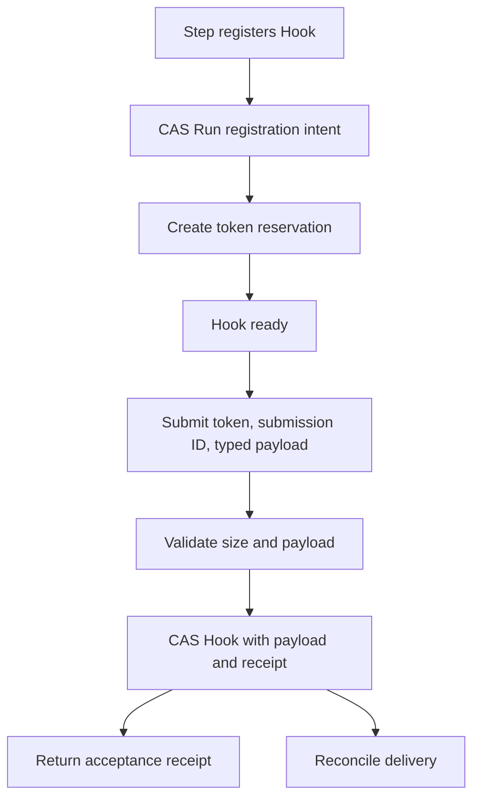

# Engine control flow

Runs live in `wf_runs`, Hook reservations and accepted inputs in `wf_hooks`, and Step deliveries in `WF_STEPS`. All record changes use revision checks. See [ADR 0004](adr/0004-shared-durable-hook-delivery.md) for the shared human and callback delivery design.

## Registration and acceptance

A Step declares `Input: engine.HookType[T]("contract-v1", validate)`. Its validation function checks required fields and application constraints; JSON decoding rejects unknown fields and null. Change the contract version whenever validation rules change. The persisted contract also includes the Go type's structure and JSON tags.

`run.RegisterHook(ctx, name, token)` persists registration intent on the Run before reserving the token. An empty token generates one only for a new intent. Repeated registration of the same name recovers the same token and contract. One unconsumed wait is allowed per Run. Names cannot be reused for later Steps.

Register before calling an external service. The registration does not save in-flight State. Step side effects need their own idempotency keys because workers can overlap or crash after an external call.

`HookInput[T](ctx, run, name, token)` combines registration and input reading. Missing input returns `ErrPark`. A Step may also register first, perform an external call, then call `HookInput` to check whether input already arrived.

`Submit` and Run-scoped `Resume` use the same acceptance operation. The first valid submission wins. Identical retries return the immutable receipt, including after consumption or failure. A changed payload or submission ID conflicts. JSON comparison ignores object order, whitespace and numeric spelling without rounding large numbers. The token is hashed before use as a KV key.

The receipt means input is durable. Step-stream publication failure after acceptance cannot invalidate it. Failed Runs reject new input until Retry; their accepted input stays available.

## Delivery and consumption

`Serve` watches Runs and Hooks and reconciles every second. A pass reads only Runs that changed, had a Hook change, are running, or are due, so finished and waiting Runs cost no request. It repairs interrupted registrations and publications. When a matching parked wait has input, a Run CAS records running status and a fresh execution identity. Reconciliation republishes that same identity after interruptions.

Step messages carry both Step index and execution identity. The executor rejects stale generations even after the JetStream dedup window. Registration writes preserve the execution identity. Retry, wakeup and successful Step advancement create a fresh identity.

If input arrives while a Step is running, it stays in the Hook. The Step can read it or return `ErrPark`; reconciliation then wakes the parked Run. Submission never merges input into in-flight State.

A successful Step commits its State, next Step and consumed submission ID together in one Run CAS. Reconciliation then marks the Hook consumed. A failed Step keeps its accepted input for Retry. Revision checks protect committed State, but do not make external side effects exactly once.

## Storage and cleanup

The default payload limit is 64 KiB. `Config.HookPayloadLimit`, `HookMaxBytes` and `StepMaxBytes` configure limits. Both stores reject new writes when full; accepted input is never evicted to admit other input. Hook and Step stores each default to 64 MiB. Hook capacity includes permanent reservations, which grow over time and eventually require more storage. Hook history is one revision so cleanup removes retained payloads and receipts.

Terminal Runs receive a seven-day retention deadline. Retry clears it through a Run revision check. Cleanup purges the Run with its last revision, so Retry and deletion cannot both win. Only after Run removal does cleanup strip Hook payloads and receipts, preserving the token reservation as `gone`. A reservation scan when `Serve` starts recovers interrupted cleanup. Unknown tokens return not found; cleaned tokens return gone.

## Scheduling and failure

Scheduled Runs use the native `WF_SCHEDULES` stream. Reconciliation republishes missing schedules, and the starter claims a due Run before enqueuing its first Step. Cancel and Reschedule use Run revision checks. See [scheduled Runs](scheduled-runs.md).

Step failures use the consumer delivery budget. `ErrTerminal` fails immediately; the last failed delivery also records failed status. Retry starts the failed Step with a fresh execution identity and budget. Earlier Step outputs remain committed.

| Interruption | Recovery |
| --- | --- |
| Run intent saved, token not reserved | Reconciliation reserves the same token. |
| Token reserved, Step interrupted | Re-registration recovers the same Hook. |
| Acceptance saved, response lost | Same submission ID and payload return the receipt. |
| Input accepted before Park | Park commits; reconciliation wakes the matching wait. |
| Wakeup saved, publication lost or stream full | Reconciliation republishes the persisted execution identity. |
| Step committed, Hook not marked consumed | Run consumption record repairs Hook status. |
| Run removed, payload cleanup interrupted | Reservation scan strips input and keeps the token. |

`Wait` watches Run revisions. Run details include Hook name, token, status and receipt acceptance time. Accepted and consumed are separate from the Run's Step completion status.
